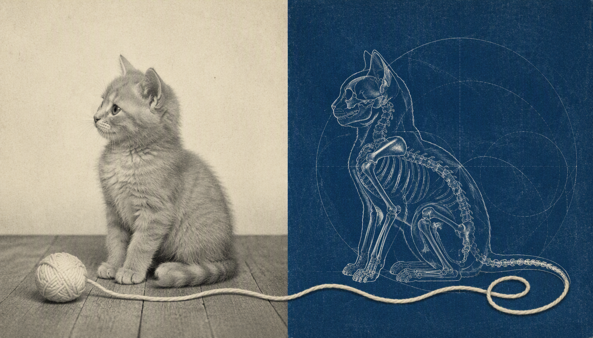
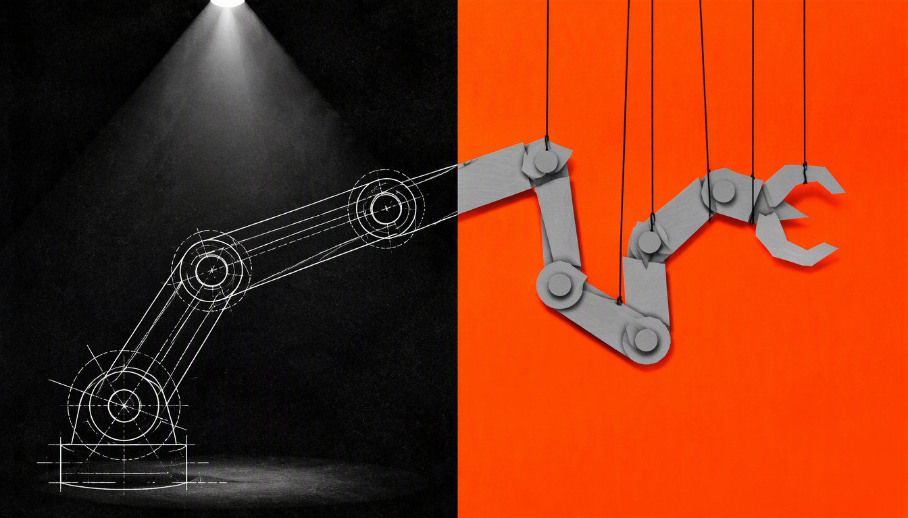
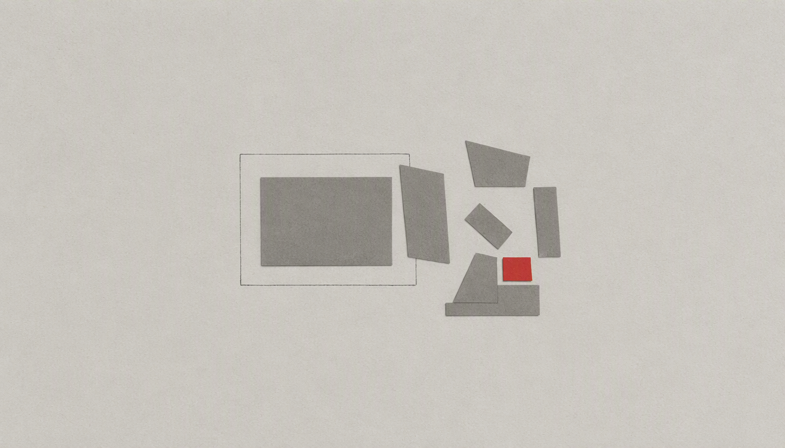
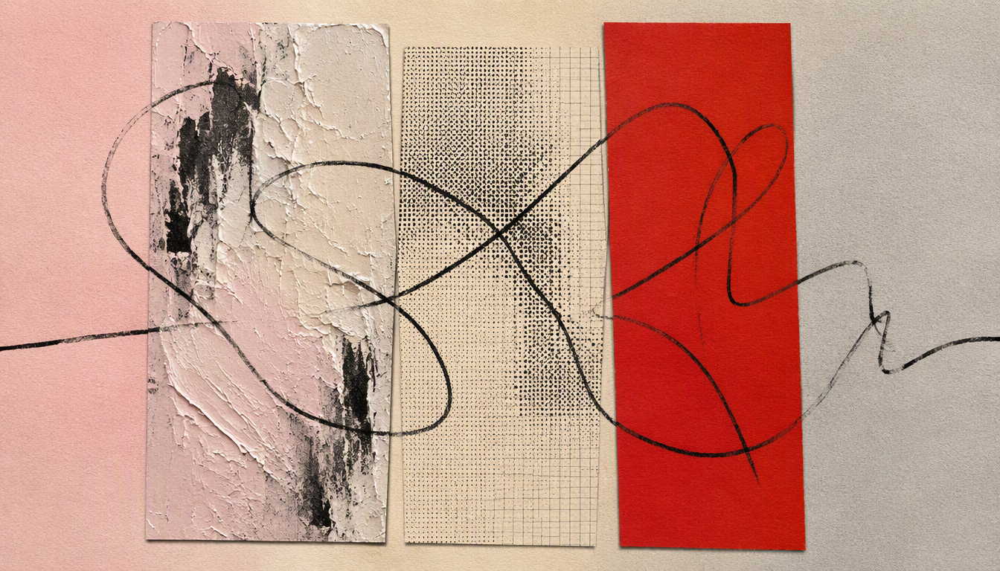
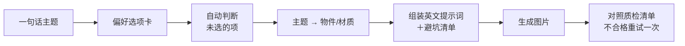

<div align="center">

# 🎨 Anthropic-Style Image Skill

**一句话主题，生成 Anthropic 风格的编辑感配图**

*Turn any topic into an editorial, paper-textured collage illustration inspired by Anthropic's visual language.*


</div>

<table>
  <tr>
    <td></td>
    <td></td>
  </tr>
  <tr>
    <td></td>
    <td></td>
  </tr>
</table>

<p align="center"><sub>以上四张均由本 Skill 生成，生图模型 GPT Image 2.1，输入只有一句话主题。</sub></p>

---

## ✨ 为什么做这个

Anthropic 的文章封面很好认：暖色纸张、档案照片、手绘线条、克制的配色，只留一个亮色焦点。它高级，但很难用一句提示词复刻——直接说"Anthropic 风格"，生图模型通常只会给你一张米色背景的普通插画。

这个 Skill 把这套视觉语言拆成了**可执行的规则**：

- 🎨 **从视觉灵感到风格规则**：参考 Anthropic 官网文章插图，将纸张质感、编辑式拼贴、配色与构图整理成可执行的规则
- 🧠 **会把主题翻译成画面**：不画"AI""未来"这类空泛概念，而是转成具体物件或材质（安全 → 黄铜挂锁，成长 → 攀爬的植物茎）
- 🎛️ **偏好可选，也可全自动**：8 个维度的选项卡，不选的项由 AI 按主题判断，并在生成前告诉你它选了什么、为什么
- 🚫 **内置避坑清单**：渐变、3D、发光、毛玻璃、乱码文字、角落水印……都在提示词里提前排除

## 🖼️ 示例

| 输入 | 输出 | 画面在表达什么 |
|---|---|---|
| `给 ai对宠物的影响 这个文章配图` |  | **科技与宠物生活**：技术分析视角与宠物的生命、情感并置。毛线呼应猫咪玩耍的日常，也连接两种视角，让科技主题多一点温度与轻松感。 |
| `机器人现状配图` |  | **机器人的能力与控制**：精密的机械臂设计图与被绳子吊起的纸板机械臂形成反差，以幽默的方式探讨机器人展示出的强大形象、实际能力与人类控制之间的关系。 |
| `ai对工作岗位的冲击配图` |  | **工作内容的拆解与重组**：完整的灰色矩形被拆成几何块，再形成新的组合；红色小块标出变化的关键。侧重任务与工作结构的重构，而非直接描绘失业。 |
| `ai对艺术的冲击 配图` |  | **AI 与艺术创作**：粗粝的颜料肌理、规整的网点网格和醒目的红色色块，由一条黑线串联，呈现人类感性表达与算法秩序之间的张力和交织。 |

> 示例均为 1344×768（16:9）。图注是创作意图与视觉解读，不是对相关议题的事实结论。

## 🚀 快速开始

**最简单的用法——只给主题：**

```text
用 anthropic-style-image 给《企业如何开展 AI 转型》配一张公众号头图，其他你来定。
```

**指定偏好：**

```text
用 anthropic-style-image 生成配图。
主题：团队协作。
档案拼贴，奶油色＋灰蓝，三栏构图，直线切分，加一组贯穿画面的圆片，不要文字。
```

**描述得更具体，效果更可控：**

```text
为《AI 对艺术创作的冲击》生成文章配图，表现人类感性创作与算法秩序之间的碰撞和交织，
不把 AI 单纯描绘为威胁。
```

更多进阶写法：

| 主题 | 进阶描述 |
|---|---|
| AI 对宠物的影响 | 表现技术观察与宠物真实生命、情感之间的关系，带一点温暖和轻松感 |
| 机器人现状 | 用一点幽默感表现机器人展示出的先进形象与实际能力、人类控制之间的反差 |
| AI 对工作岗位的冲击 | 侧重工作任务被拆解、调整和重组，不直接描绘失业场景 |

## 🎛️ 偏好选项

开始生成前，Skill 会给出一张选项卡。直接回编号（如 `A6 B1 C2 H3`），或回"默认"全部交给 AI 判断。

| 维度 | 选项 |
|---|---|
| **A 用途/比例** | 文章封面 16:9 · 社媒方图 1:1 · 竖版海报 3:4 · 手机竖屏 9:16 · 横幅 21:9 · 公众号头图 |
| **B 风格方向** | 档案拼贴 · 电影感 · 静物单品 · 抽象材质拼贴 |
| **C 配色** | 暖纸＋珊瑚橘 · 奶油＋灰蓝/青 · 米黄＋苔绿 · 浅粉＋炭黑 · 深色＋橘光 · 自定义 |
| **D 主体素材** | 植物 · 金属小物件 · 天空山石 · 建筑城市 · 科学图像 · 手与劳作 |
| **E 构图** | 两栏对比 · 三栏拼接 · 单主体＋大留白 |
| **F 画面文字** | 不要文字（推荐） · 一个短标题 |
| **G 拼接交界** | 自动 · 撕纸毛边 · 直线切分 · 胶片条带 · 几何裁切 · 纸片叠压 |
| **H 贯穿元素** | 自动 · 不要 · 重复圆片 · 重复纸片 · 跨栏手绘线 |

### 四种风格方向

| 方向 | 特点 | 适合 |
|---|---|---|
| **档案拼贴** | 实拍照片＋纸张＋技术图纸/手绘线，分栏拼接 | 研究、科技、商业等文章封面 |
| **抽象材质拼贴** | 不放照片，只用色块、纸片、大理石纹、网点和一条手绘线 | 情绪、对话、陪伴、价值观等没有具体物件的主题 |
| **电影感** | 近黑背景、局部暖光、一个小而有质感的主体 | 发布、里程碑 |
| **静物单品** | 一个实物放在纯色纸上，大量留白 | 能用单个物件承载的主题，如安全、单一产品 |

### "自动"是怎么判断的

不选的项不是随机生成。写提示词的 AI 会按 Skill 里的规则判断，例如：

- 主题是情绪、对话、陪伴 → **抽象材质拼贴**
- 主题涉及流程、阶段、连接、转变，或用了三栏构图 → 加**贯穿元素**
- 主题偏技术、数据、安全 → **直线切分**或**几何裁切**；偏人文、历史、自然 → **撕纸毛边**或**纸片叠压**

生成前它会用一句话说明方案，比如：

```text
档案拼贴｜暖纸珊瑚橘｜三栏｜直线切分｜贯穿：重复圆片（主题是流程推进）
```

一次生成两张时，两张只在一个自动维度上不同（比如一张有贯穿元素、一张没有），方便你直接对比挑选。

## ⚙️ 工作流程



## 📦 安装

只需复制仓库里的 **`anthropic-style-image/` 子文件夹**，`examples/` 只是 README 的示例图，不用安装。

```bash
git clone https://github.com/<your-name>/<repo-name>.git
```

### CodeBanana

把 `anthropic-style-image/` 子文件夹放进项目的 Skills 目录：

```text
.codebanana/.skills/anthropic-style-image/
```

CodeBanana 内置生图工具，Skill 会直接出图。默认模型为 Seedream 4.5；需要画面文字时切换到 NanoBanana Pro；你也可以指定其他模型，比如本 README 的示例使用的是 GPT Image 2.1。

### Claude Code 及其他支持 Agent Skills 的环境

放到对应的 Skills 目录，例如 Claude Code：

```text
.claude/skills/anthropic-style-image/      # 当前项目
~/.claude/skills/anthropic-style-image/    # 所有项目
```

> ⚠️ Skill 里的出图步骤写的是 CodeBanana 的 `media_creator_image` 工具。在没有生图工具的环境里，Skill 会**输出最终的英文提示词和画面比例**，你可以复制到 GPT Image、Midjourney、即梦等任意生图工具里使用。如果你的 Agent 接了别的生图工具，把 `anthropic-style-image/SKILL.md` 第 6 步换成对应的工具即可。

## 📁 文件结构

```text
.
├── README.md
├── examples/                        # README 示例图（无需安装）
│   ├── ai-pets.png
│   ├── robot-reality.png
│   ├── ai-jobs.png
│   └── ai-art.png
└── anthropic-style-image/           # ← Skill 本体，安装时只复制这个文件夹
    ├── SKILL.md                     # 工作流程、偏好卡、自动判断规则、质检清单
    └── references/
        ├── style-guide.md           # 风格指南：材质词库、配色色值、构图规则
        └── prompt-templates.md      # 四种风格的提示词模板、交界/贯穿元素片段、主题→物件映射、示例
```

## 💡 使用建议

- **主题越具体，画面越有意思。** "AI 转型"不如"传统企业的 AI 转型，从小流程开始试"。
- **先默认，再微调。** 第一次全部交给自动，看完再说"换成冷色""去掉贯穿元素""改成抽象拼贴"。
- **尽量不要在图里放文字。** 生图模型容易出现乱码；标题建议后期排版加上。
- **公众号头图**选 A6：会按 21:9 生成；模型不支持时，用 16:9 并让主体居中，方便裁切。

## 🙋 FAQ

**生成的图是 Anthropic 官方素材吗？**
不是。这是风格参考，生成的是全新图片。Skill 会主动避免 Anthropic / Claude 的 Logo、字标和星芒标识，也不会复刻任何具体作品。

**必须用 GPT Image 2.1 吗？**
不必须。示例用的是 GPT Image 2.1，Skill 本身不绑定模型；不同模型对纸张质感、线条和文字的表现会有差异。

**为什么每次结果不完全一样？**
生图模型本身有随机性。Skill 能保证风格方向和画面结构，但具体细节每次会有变化，这也是默认一次生成两张的原因。

## 📚 参考与声明

- 视觉灵感来自 Anthropic 官网文章插图，借鉴其纸张质感、编辑式拼贴与克制配色。本项目非 Anthropic 官方出品。
- 品牌色值参考 Anthropic 公开的 [brand-guidelines skill](https://github.com/anthropics/skills)。
- 本项目与 Anthropic 无任何关联，也未获其认可。Anthropic 和 Claude 是 Anthropic PBC 的商标。
- 本仓库的开源许可只覆盖 Skill 文件和示例图，不覆盖任何 Anthropic 原始图片。

## 🤝 贡献

欢迎提交 Issue 和 PR：

- 分享你用这个 Skill 生成的图（附主题和模型），优秀作品会加入示例区
- 补充新的"主题 → 物件"映射
- 提供在其他生图模型上的测试结果和适配建议

## 📄 License

<!-- 上传前请选择许可证，例如 MIT，并在仓库根目录添加 LICENSE 文件 -->
待补充。

---

<div align="center">

如果这个 Skill 帮你做出了好看的配图，欢迎点一个 ⭐ Star，让更多人看到。

</div>
